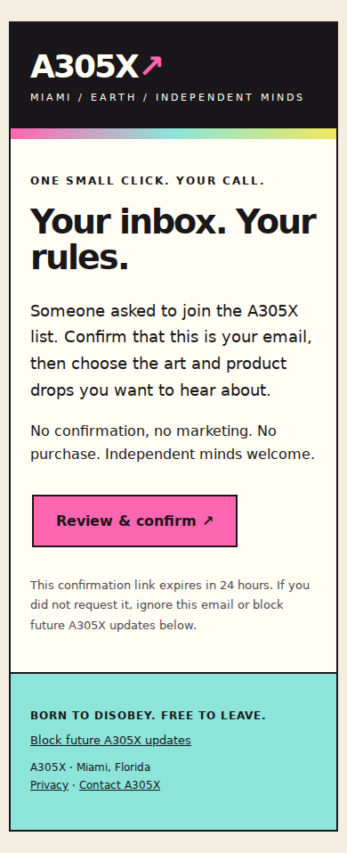
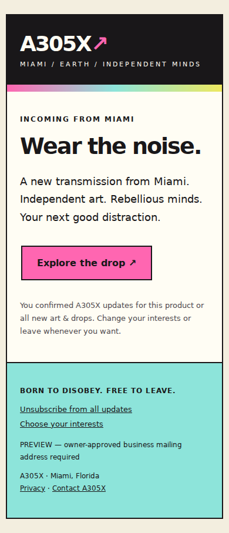

# A305X subscription and launch-email operations

## What is implemented

The static website uses the existing private Vercel Blob store and Resend's
sending API. No provider contacts, broadcasts, recurring automation, new paid
plan, or additional database is required. Confirmation and launch email templates
include responsive layouts, text alternatives, A305X Miami colors, sender
identity, and opt-out links. Marketing also includes an approved physical business
mailing address and RFC 8058 one-click unsubscribe headers.

A new request remains `pending` until an address owner opens a signed link and
explicitly submits selected interests and consent. Tokens expire after 24 hours;
GET requests from mail scanners never verify or unsubscribe an address. Link
secrets are at least 32 bytes, purpose-separated, and only hashes of confirmation
bearer tokens are stored. Links use URL fragments on the public management page;
the page removes the fragment immediately and has no analytics or third-party
scripts. One-click email-client opt-outs use a signed query token and POST as
required by RFC 8058; hosting request logs may contain that endpoint's token, so
limit access to those logs and do not retain/export full URLs unnecessarily.

Requests use a per-IP five-per-ten-minute limit and a per-address confirmation
limit of three per hour with a 60-second cooldown. Private storage reads bypass
caches, fail closed, and use version-conditional writes and no-overwrite creates.
The extra abuse limits are stored privately. Configure an edge rate limit if
large-scale automated abuse becomes a problem; none was purchased here.

## Existing records and suppression

**Do not replace the Blob store, export subscriber addresses to git, bulk mark
legacy addresses verified, or send a legacy reconfirmation campaign.** Existing
`emails/<sha256(email)>.json` paths, joined dates, original consent fields, other
metadata and historical requested interests are retained. There is no bulk
migration. Existing records are read and updated individually on visitor actions.
A `status: subscribed` or old `emailVerified` field alone is insufficient for
marketing. Eligibility also requires this flow's confirmed-consent version,
confirmation date and explicitly confirmed `verifiedInterests`.

`interests` preserves historical requests; `verifiedInterests` alone controls
active targeting. Unauthenticated repeat signup cannot broaden a confirmed
subscriber's marketing topics. The owner reviews topics on the confirmation page
or manages them through a purpose-signed preferences link. A repeat confirmation
cannot replay to change interests.

Any unsubscribe, including an address unknown to the old list, creates/keeps a
suppression tombstone. Previously unsubscribed, bounced, complained or suppressed
addresses cannot be re-enrolled by this public flow. There is deliberately no
automatic unsuppression, and a provider `suppression.removed` event never clears
the website's block. The original requested interests and consent records remain.
For deletion requests, remove personal fields only after verifying the request;
retain the minimal hashed suppression key so a later import cannot accidentally
restore marketing eligibility. No cleanup/delete job is installed by this change.

## Activation checklist for the existing Production project

1. Use the existing Vercel project `antiwar-flock` in
   `usivaylo-5363s-projects` (`prj_xb2Q7jgqxXY5Q1FXR4ZEzN6u9OYg`). Inspect variable
   **names/scopes** in the dashboard without printing secrets. Keep its current
   private Blob credentials/store. Use separate test storage for previews.
2. In the authorized Resend account, verify `a305x.com` (or an A305X sending
   subdomain). Publish the provider's **actual** DKIM and return-path SPF/MX
   records at the authoritative DNS provider. Preserve existing mail records;
   do not add a second SPF record at one hostname. Verify DMARC alignment and a
   policy for the sender domain. Use no other brand's domain or `resend.dev` as a
   production sender. Disable open and click tracking, including domain-level
   tracking, so links work as designed and the privacy notice remains accurate.
3. The inspected account was at its three-domain limit, with **no verified
   domain**. Do not delete/replace another project's domain or upgrade a plan
   without the owner's decision. A free slot must be made available before
   adding A305X. The account reported 100 daily / 3,000 monthly emails at inspection;
   quotas and plan names must be checked again when activating.
4. Create a sending-only key restricted to the verified A305X domain. Set
   `RESEND_API_KEY`, `EMAIL_FROM` (exact form `A305X <updates@a305x.com>` or the
   verified A305X subdomain), and an independent random `EMAIL_TOKEN_SECRET`.
   Keep the token secret stable; rotating it invalidates confirmation, preference
   and unsubscribe links already sent. Never share keys in chat or commit them.
5. Register `https://www.a305x.com/api/email-webhook` in Resend for `email.sent`,
   `email.delivered`, `email.delivery_delayed`, `email.failed`, `email.bounced`,
   `email.complained`, `email.suppressed`, and `suppression.added`. Put its signing
   secret into `RESEND_WEBHOOK_SECRET`. **Test actual signed events before
   enabling marketing.** Raw-byte Svix verification and timestamp checks reject
   forged/stale events. The endpoint acknowledges only after durable updates;
   failures return 503 so the provider can retry. It ignores engagement events.
6. Set `EMAIL_ENABLED=true` for Production and redeploy. Keep
   `EMAIL_MARKETING_ENABLED=false` for now. `GET /api/join` must report
   `available: true` and `confirmationAvailable: true`. A false confirmation flag
   means capture-only: the UI says the address is saved but is not enrolled and
   asks visitors to return later. Nothing drains a pending list automatically.
7. Have the owner explicitly register their own approved test mailbox, verify
   receipt in that inbox, open its link, review interests, and confirm. Test a
   repeated request and an expired link. Use a different test address to exercise
   unsubscribe, since suppression is deliberately permanent in the public flow.
8. Supply the owner-approved **business** postal address in
   `EMAIL_POSTAL_ADDRESS` and a separate `EMAIL_ADMIN_SECRET` (32+ characters).
   Configure `EMAIL_TEST_RECIPIENTS` with only explicitly authorized test addresses.
   Set `EMAIL_MARKETING_ENABLED=true` and redeploy only after the above checks.
   This flag makes the operator tool usable; it never initiates a campaign.
9. Send the single allowlisted test below, inspect its appearance in a real
   mailbox, and confirm `email.delivered` from a signed webhook. A provider API
   ID establishes acceptance only. Even `email.delivered` establishes delivery to
   the recipient's mail server, not inbox placement or a human read.

No real email, domain deletion, paid subscription, list import or campaign was
initiated during implementation. The production configuration could not be read
because the Vercel connector denied access to the project's team scope. Its CLI
fallback had no credentials. No delivery webhooks were configured in the inspected Resend account. The old live `GET /api/join` returned
`available: true`, establishing private-read connectivity only, not a subscriber
inventory or verified sending setup. See the release verification record for the
actual final deployment result.

## Review and authorize each campaign

Create a JSON draft **outside the public web root**, for example:

```json
{
  "id": "tee-launch-2026-unique-id",
  "product": "tee",
  "title": "Wear the noise.",
  "message": "Replace this draft with owner-approved facts and launch availability.",
  "path": "/store"
}
```

Products are `tee`, `flying-fluck`, `wall-art`, `chill-pill`, `field-manual`,
`drama-dump`, or `all`. A product send includes that product's confirmed opt-ins
and confirmed `all` opt-ins. A general `all` announcement includes only `all`
opt-ins. Recheck actual product availability before approving copy.

Set `EMAIL_ADMIN_SECRET` in the operator's local environment, without exposing it
in flags or output. The CLI calls only the canonical A305X site and never reads
production Blob or provider credentials.

```bash
# Read-only audience/content preview; never sends.
node scripts/email-launch.mjs preview /private/draft.json > /private/preview.json

# One explicit owner-approved test; recipient must be allowlisted AND confirmed.
node scripts/email-launch.mjs test /private/draft.json --to owner-approved-address
```

Review the draft, rendered email preview (including sender and mailing address), recipient count and both digests. Obtain the owner's explicit
approval of **that exact content and audience**. Only then run, using the exact
`approval` phrase from the preview:

```bash
node scripts/email-launch.mjs approve /private/draft.json --preview /private/preview.json --approval 'APPROVE ...'
node scripts/email-launch.mjs send /private/draft.json --preview /private/preview.json --approval 'APPROVE ...'
```

Approval fails if the audience or content changed after preview. The content digest also covers rendered templates, sender and postal address; a later rendering/configuration change blocks dispatch until a new campaign is reviewed. The private
manifest fixes the approved recipient keys and expires in 24 hours. New signups
never enlarge it. Each send processes at most three recipients and rechecks
confirmed status, product targeting and suppression immediately before handing
each message to the provider. Use `node scripts/email-launch.mjs status /private/draft.json` to review pending, accepted, recipient-server delivered, failed and suppressed counts without sending. Re-run the same send command to resume the same
campaign; do not invent a new campaign ID just to retry delivery. A maximum of
100 recipients per approval bounds this manual tool. Check the provider's
remaining daily/monthly quota before authorization; do not increase a plan to
accommodate a campaign without authorization.

Private journals plus provider idempotency keys prevent duplicate sends under
concurrent requests/retries. Transient 429/5xx or network failures are retryable
with the same request/content, not new keys. Wait at least a minute before manual
retry; there is no background retry cron or queue subscription. A terminal 4xx
requires operator investigation. An ambiguous attempt over 23 hours old, or a
changed payload on retry, is held as `uncertain`, requiring provider-log review
instead of risking a duplicate after provider idempotency expiry. Signed failed
or suppressed events do not automatically requeue accepted messages.

An unsubscribe received after a message has already been handed to the provider
cannot retract that in-flight message. Future eligibility checks use fresh
private reads and terminal suppression state. No mass mailing is authorized by
shipping this implementation.

## Evidence and verification

Run `npm ci --ignore-scripts` and `npm test`. The tests execute actual handlers and
storage logic against isolated, versioned in-memory storage, a simulated email
provider, and real Svix signature verification. They do not touch production
subscribers or send real mail. The single-recipient test in this suite is a
simulation, **not confirmed production receipt**.

Persisted provider statuses are under `email-delivery/<sha256(provider-id)>/`;
send attempts under `email-sends/`; campaign approval manifests under
`email-campaigns/`; processed-event markers under `email-events/`. Keep these
paths private. Do not expose addresses, tokens, raw webhook payloads, IPs or
provider error bodies in public logs. Delivery journals do not include message
bodies or raw confirmation tokens. Review transient logs after 90 days and retain
only what is needed for delivery investigations; preserve consent and minimal
suppression records. No automatic retention/deletion is enabled.

## Design previews

The production templates are in `api/_lib/email-templates.js`. Regenerate safe,
non-deliverable HTML/text samples with `node scripts/preview-email.mjs`. Sample
links are placeholders and never enroll or unsubscribe anyone.

[Confirmation HTML](email-previews/confirmation.html) ·
[Launch HTML](email-previews/launch.html)

| Confirmation email at 390 px | Launch email at 390 px |
| --- | --- |
|  |  |
